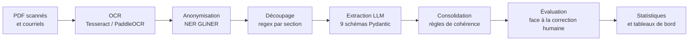

# Extraction d'informations d'ordonnances de protection par LLM

Pipeline d'**OCR, d'anonymisation et d'extraction structurée par grand modèle de langage**, appliqué à des
décisions de justice. Développé pendant mon stage IA / NLP au **ministère de la Justice** (juin – août 2026).

> **⚠️ Aucune donnée n'est incluse dans ce dépôt.** Les ordonnances traitées sont des documents judiciaires
> privés, qui contiennent des données personnelles sensibles. Seul le code est publié, avec l'accord du
> ministère. Voir [`data/README.md`](data/README.md).

## Contexte

L'**ordonnance de protection** est une décision du juge aux affaires familiales (JAF) qui protège en urgence une
personne victime de violences conjugales : interdiction de contact, attribution du logement, bracelet
anti-rapprochement… Pour étudier ces décisions à grande échelle, le ministère s'appuie sur une grille d'analyse
d'environ **330 variables** par dossier : procédure, profil des parties, violences dénoncées, demandes, décision
du juge, etc.

Remplir cette grille à la main prend beaucoup de temps. L'objectif du stage était de **l'automatiser avec un
LLM**, de **mesurer la fiabilité** du résultat face à une correction humaine, puis d'exploiter la base obtenue.

## Pipeline



| Étape | Fichiers | Ce qui est fait |
|-------|----------|-----------------|
| **Préparation** | `scan_msg.py`, `scan_fusion.py`, `renommer_doc.py`, `recup_numero_RG.py` | Extraction des pièces jointes des courriels, fusion des scans, renommage par numéro RG |
| **OCR** | `ocr.py`, `better_ocr.py` | Tesseract en version de base. Version améliorée : nettoyage d'image avec OpenCV (effacement des surlignages), puis PaddleOCR |
| **Anonymisation** | `anonymize_json_better.py` | Détection des entités nommées avec GLiNER (NER multilingue en vocabulaire ouvert), texte traité par blocs pour garder la précision |
| **Découpage** | `decoupe_opvc_regex.py` | Segmentation de l'ordonnance (identification, prétentions, motifs, dispositif) par expressions régulières robustes aux erreurs d'OCR |
| **Extraction** | `llm_pydantic_opvc_2021.py`, `src/schemas/`, `prompts/` | Appels asynchrones au LLM via `instructor`. La sortie est validée par 9 schémas Pydantic, avec relance automatique en cas d'échec. Option : **justification** de chaque champ par une citation du texte |
| **Consolidation** | `jointure_json.py`, `json_to_database.py` | Fusion des 9 sections par dossier, règles métier de cohérence, base tabulaire finale |
| **Évaluation** | `compare_database.py`, `src/statistique/scoring_llm_humain.py` | Alignement avec la grille remplie à la main, score par variable, par dossier et par famille de variables |
| **Restitution** | `apps/`, `src/statistique/` | Tableaux de bord Streamlit, cartes par ressort de cour d'appel, analyses statistiques |

### Extraction contrainte par schémas

Chaque section de la grille correspond à un **schéma Pydantic** : champs typés avec les codes admis
(`Literal`), dates, champs inconnus interdits (`extra="forbid"`) et validateurs de cohérence. Les consignes de
codage de chaque variable sont dans [`prompts/`](prompts). Le LLM ne peut donc renvoyer que des codes valides :
une réponse non conforme est rejetée puis redemandée. Le découpage en 9 sections
(procédure, profil social, violences dénoncées, demandes, réponses du juge, décision, bracelet
anti-rapprochement…) garde des prompts courts et ciblés.

Le mode **avec justifications** enveloppe chaque schéma pour exiger, pour chaque champ, la citation du texte
qui fonde la réponse. Il ralentit l'extraction, mais rend chaque valeur **vérifiable** par un humain. Une
application dédiée permet de confronter la réponse humaine, la réponse du modèle et sa justification.

### Méthodes comparées

| Méthode | Entrée du LLM |
|---------|---------------|
| **M1** | Texte OCR complet |
| **M2** | Texte découpé par section (seule la partie utile est envoyée à chaque schéma) |
| **M3** | Texte issu de l'OCR amélioré (OpenCV + PaddleOCR) |
| **M4** | Hybride : M3 par défaut, M2 pour les variables où il fait mieux |

L'application `apps/comparaison.py` compare ces méthodes variable par variable. Elle propose aussi un mode
« strict », limité aux cas où l'humain et le modèle ont tous deux répondu. Dans M4, quelques variables sont
comptées comme correctes : l'analyse des justifications avait montré que les écarts venaient d'erreurs de la
correction humaine. Le score de M4 est donc à lire comme une estimation corrigée, pas comme une mesure brute.

### Analyse des erreurs

Au-delà du taux de réussite, `scoring_llm_humain.py` cherche **où et pourquoi** le modèle se trompe :
- scores par variable, par dossier et par famille de variables, avec intervalles de confiance de Wilson ;
- test de **Kruskal-Wallis** et tests post-hoc de Dunn entre familles de variables ;
- **régression logistique** (statsmodels) de l'échec selon les caractéristiques du dossier (odds ratios et IC à
  95 %) ;
- **classification hiérarchique** des variables qui échouent ensemble, et K-means des dossiers (visualisé par ACP).

## Utilisation

```bash
python -m venv .venv && source .venv/bin/activate
pip install -r requirements.txt
cp .env.example .env   # URL, clé et nom du modèle (API compatible OpenAI)
```

Pipeline complet en ligne de commande (extraction, fusion, consolidation, comparaison) :

```bash
python main.py
```

Le menu propose quatre modes : texte complet, texte découpé, OCR amélioré, ou **QCM libre**. Ce dernier pose une
question à choix multiples sur l'ensemble des documents, pour une exploration ponctuelle.

Tableaux de bord :

```bash
streamlit run apps/comparaison.py   # fiabilité des méthodes et analyse des justifications
streamlit run apps/question.py      # exploration de la base, croisements entre questions
streamlit run apps/resultat.py      # statistiques descriptives
```

Le [guide technique](GUIDE_TECHNIQUE.md) détaille le rôle de chaque fichier.

## Structure

```
├── main.py                  # orchestrateur en ligne de commande
├── src/
│   ├── llm_pydantic_opvc_2021.py   # extraction LLM (instructor + Pydantic, asynchrone)
│   ├── schemas/             # 9 schémas Pydantic, un par section de la grille
│   ├── ocr.py, better_ocr.py
│   ├── anonymize_json_better.py
│   ├── decoupe_opvc_regex.py
│   ├── jointure_json.py, json_to_database.py, compare_database.py
│   └── statistique/         # scoring, modélisation des erreurs, cartes
├── apps/                    # tableaux de bord Streamlit
├── prompts/                 # consignes de codage envoyées au LLM, par section
└── data/README.md           # données non fournies (privées)
```

## Confidentialité

- **Anonymisation en amont** : les textes OCR sont anonymisés (GLiNER) avant d'être envoyés au modèle.
- **Modèle configurable** : le modèle est interrogé via une API compatible OpenAI, dont l'URL et la clé sont
  lues dans `.env` (une instance Open WebUI pendant le stage). Aucune clé n'est présente dans le code.
- **Aucune donnée dans le dépôt** : le `.gitignore` bloque par défaut tous les formats de données (PDF, JSON,
  Excel, CSV) ainsi que les journaux. Les numéros de dossier présents dans le code sont fictifs.

## Stack

Python · LLM (API compatible OpenAI) · instructor · Pydantic · asyncio · Tesseract · PaddleOCR · OpenCV ·
GLiNER · pandas · statsmodels · scikit-learn · SciPy · GeoPandas · Streamlit · Plotly

## Auteur

Adam Laporte, élève ingénieur à l'ENSAI, stagiaire au ministère de la Justice.
